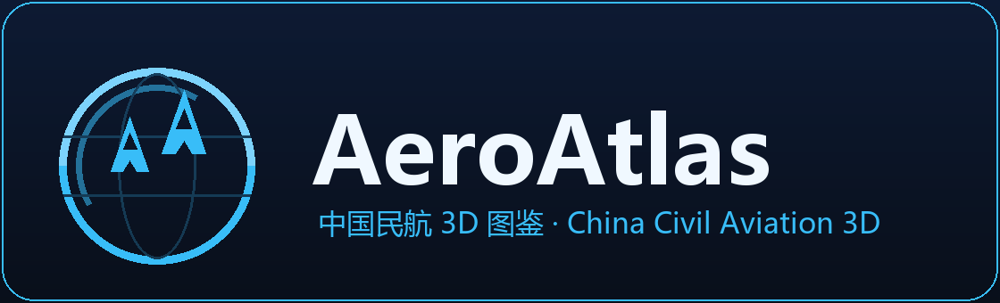

<p align="center">
  
</p>

<h1 align="center">AeroAtlas</h1>

<p align="center">
  <strong>中国民航 3D 图鉴 · China Civil Aviation 3D Atlas</strong><br>
  纯静态、可离线的浏览器端航空知识平台 —— 3D 赏机 · 涂装切换 · 机场图鉴 · 民航百科 · 答题闯关
</p>

<p align="center">
  <a href="https://zhu-zirui.github.io/cloud-hangar/" target="_blank">🌐 在线体验 / Live Demo</a>
  · <a href="https://github.com/Zhu-Zirui/cloud-hangar/issues" target="_blank">💬 反馈 / Issues</a>
  · <a href="assets/CREDITS.md">📎 素材来源 / Credits</a>
  · <a href="LICENSE">📄 License</a>
</p>

<p align="center">
  
  
  
  
  
</p>

---

## 为什么叫 AeroAtlas?

**AeroAtlas 简称 AA —— 恰好是中国民航 CAAC(Civil Aviation Administration of China)中间的两个字母。**

站标由此而来:每个字母 **A** 同时是一架三角翼飞机,双机沿轨道弧编队爬升,外圈圆环既是图集(Atlas)也是地球。AA 既是品牌,也是致敬中国民航。

> AeroAtlas is abbreviated **AA** — the two letters in the middle of **CAAC**. In our logo, each letter "A" is also a delta-wing aircraft climbing in formation along an orbit, ringed by an atlas globe.

> 前身项目名为「云端机库 Cloud Hangar」,AeroAtlas 是它的国际化升级品牌,仓库地址保持不变。

## 它是什么 / What is it

一个**无需安装、无后端、纯静态**的 3D 航空知识平台:打开浏览器即可 360° 赏机、切换真实航司涂装、走进驾驶舱与客舱、浏览全国机场、读民航百科、刷题晋级。

A purely static, backend-free 3D aviation knowledge platform — browse aircraft in 3D, switch real airline liveries, tour the cockpit and cabin, explore Chinese airports, read the encyclopedia, and level up through quizzes.

## 核心功能 / Key Features

| 模块 | 内容 / Highlights |
| ---- | ----------------- |
| ✈️ 机库 3D 图鉴 | **43 个机型变体**真实 GLB 模型(波音/空客/商飞/巴航/ATR/麦道/图波列夫/安东诺夫/福克/协和…),360° 查看、相机预设、夜间模式 |
| 🎨 涂装切换 | 787-8 等 10 款真实航司涂装整体换装,机库背景品牌联动(波音/空客/商飞…),分享卡片跟随涂装主色 |
| 🔍 部件图鉴 | 30 张部件知识卡,点击模型部件即飞行定位 + 讲解 |
| 🛫 舱内漫游 | 第一人称驾驶舱(A320 标准 SOP 起降演示、英文口令)+ 客舱漫游 |
| 🛬 机场图鉴 | **287 座中国机场**(34 个省级区域全覆盖):三视图、程序化跑道布局图、可缩放分布地图、基地航司 |
| 📖 民航百科 + 答题 | 40 条百科词条、**260 题题库**、难度自适应闯关、每日一题、错题本、收集仪表盘与徽章成就 |
| ⚖️ 机型对比 | 78 款机型全目录 12 项参数并排对比 |
| 🌍 10 语种界面 | 简中/繁中/英/法/俄/阿(RTL)/西/日/朝/印地,按 IP 归属地自动选择 |
| 🔎 全站搜索 | Ctrl+K 命令面板,机型/机场/词条一站直达 |
| 📲 PWA | 可安装到主屏,Service Worker 缓存,断网也能赏机 |

## 快速开始 / Quick Start

```bash
git clone https://github.com/Zhu-Zirui/cloud-hangar.git
cd cloud-hangar
python dev-server.py 8000     # 本地开发服务器(no-store)
# 或: python -m http.server 8000
```

打开 <http://127.0.0.1:8000/> 即可。线上版本:[zhu-zirui.github.io/cloud-hangar](https://zhu-zirui.github.io/cloud-hangar/)

## 技术栈 / Tech Stack

- 原生 **HTML + CSS + JavaScript(ES Modules)**,无框架、无构建工具
- **Three.js r160**(CDN importmap,版本锁死)+ three-mesh-bvh
- 3D 模型为真实 GLB 资产(FR24 / FlightAirMap / FGMEMBERS,GPL-2.0),自研 `dev/*.py` 转换管线(dae/ac → glTF2)
- Service Worker PWA;localStorage 本机账号与进度(不上传任何个人数据)

## 项目结构 / Structure

```text
cloud-hangar/
├── assets/
│   ├── models/        # 43 个机型变体 GLB(运行时加载)
│   ├── logos/         # 航司/厂商 LOGO 与品牌图
│   ├── icons/         # PWA 图标与 OG 分享图
│   └── CREDITS.md     # 素材来源与许可
├── css/main.css       # 全站设计系统
├── data/              # aircraft/ airports wiki quiz parts liveries…(JSON 数据)
├── js/
│   ├── core/          # store / i18n / auth / share …
│   ├── engine/        # 3D 引擎(gltfModel / families / hangarEnv …)
│   ├── interior/      # 驾驶舱与客舱
│   ├── locales/       # 10 语种语言包
│   ├── ui/            # 各页面(hangar / viewer / airports / wiki / game …)
│   └── main.js        # hash 路由与启动
├── dev/               # 模型转换与图标生成脚本(ac2glb.py / dae2glb.py / gen-icons.py)
├── index.html
├── sw.js              # Service Worker(可离线)
└── PROGRESS.md        # 开发进度账本
```

## 参与贡献 / Contributing

欢迎一切形式的贡献:机型/机场数据纠错、翻译完善、新功能想法、UI 打磨、Bug 报告。提 [Issue](https://github.com/Zhu-Zirui/cloud-hangar/issues) 或直接 Fork + PR。

数据口径:机场/机型参数以官方与权威资料为准,存疑条目在数据中带 `approx` 标记,欢迎指正。

## 许可 / License

代码:[MIT](LICENSE)。3D 模型与部分素材遵循其原始许可(主要为 GPL-2.0),详见 [assets/CREDITS.md](assets/CREDITS.md)。航司名称与标志版权归各权利人所有,本项目为非商业爱好者作品。

---

<p align="center">
  <sub>AeroAtlas · AA — 从中国民航出发,飞向世界航空知识图谱 / Starting from China civil aviation, toward a global atlas of aviation knowledge.</sub>
</p>
